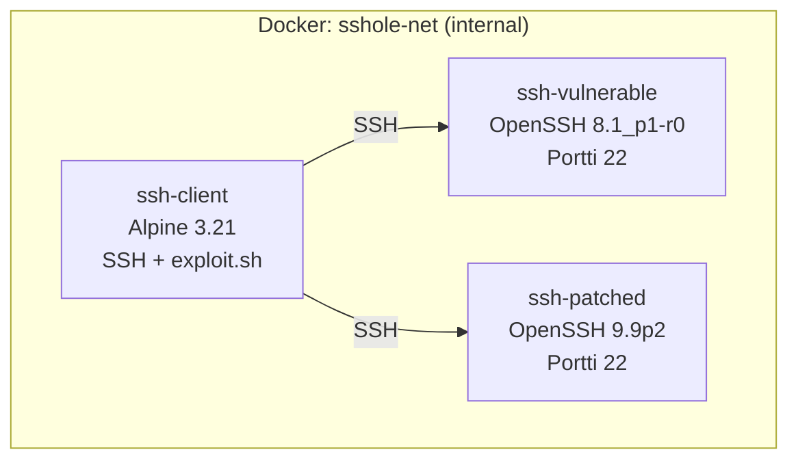

> [!NOTE]
> **🇬🇧 Note on the use of AI:** AI tools such as ChatGPT, Gemini, and Copilot were used to help develop this material.  
> **🇫🇮 Huomio tekoälyn käytöstä:** Tämän materiaalin laatimisessa on hyödynnetty tekoälytyökaluja, kuten ChatGPT:tä, Geminiä ja Copilotia.  

# 🔐 SSHole – autentikoinnin ohituksen tutkiminen Docker-laboratoriossa

**Opiskelumateriaali | Kyberturvallisuus ja penetraatiotestaus | Suljettu laboratorioympäristö**

## 1. Laboratorion tavoite

Tässä harjoituksessa tutkit SSH-palvelimen autentikointiin liittyvää haavoittuvuutta, jonka avulla käyttäjätilille voidaan tietyissä olosuhteissa kirjautua ilman oikeaa salasanaa.

Laboratorio perustuu SSHole-nimiseen Proof of Concept (PoC) -toteutukseen. Käytössä on kolme Docker-konttia: haavoittuva SSH-palvelin, vertailupalvelin sekä Linux-asiakaskontti, josta testit suoritetaan.

> **Lähdemateriaali:** [https://github.com/akarkode/alpine-openssh-sshole-auth-bypass/tree/main](https://github.com/akarkode/alpine-openssh-sshole-auth-bypass/tree/main)

**Harjoituksen jälkeen osaat:**

- selittää, miten SSH:n salasanatodennus liittyy Linuxin käyttäjätileihin, `/etc/shadow`-tiedostoon ja musl C -kirjastoon;
- erottaa haavoittuvuuden olemassaolon, sen hyödyntämisen ja onnistuneen autentikoinnin toisistaan;
- suorittaa hallittuja testejä Docker-konttien välillä;
- tulkita SSH-asiakkaan ja -palvelimen lokitietoja;
- vertailla haavoittuvaa ja korjattua ohjelmistoa sekä perustella korjausten merkityksen.

## 2. Laboratorion arkkitehtuuri



Asiakaskontti ottaa SSH-yhteyden kumpaankin palvelimeen Dockerin sisäisen DNS:n avulla. SSH-portteja ei oletuksena julkaista isäntäkoneelle.

| Komponentti | Tehtävä |
|---|---|
| `ssh-vulnerable` | Haavoittuvan autentikointitoteutuksen tutkiminen |
| `ssh-patched` | Vertailu ympäristöön, jossa ohitus ei onnistu |
| `ssh-client` | Testien suorittaminen, SSH-yhteydet ja lokien analysointi |

**Turvallisuusrajaus:** suorita kaikki testit vain tarkoitukseen rakennetussa eristetyssä ympäristössä. Dockerin `internal: true` rajoittaa kontin verkon ulkoisia yhteyksiä, mutta ei yksin muodosta täydellistä turvarajaa Docker-isäntää vastaan. Käytä mieluiten erillistä virtuaalikonetta.

## 3. Mitä haavoittuvuudessa tapahtuu?

SSH:n salasanatodennukseen osallistuvat OpenSSH-palvelin, Linuxin `/etc/shadow`-tiedosto sekä musl libc:n `crypt()`-toiminto.

```text
SSH-asiakas (salasanasyöte) → OpenSSH (todennuslogiikka) → musl / shadow (salasanan tarkistus)
```

Tavallisesti `/etc/shadow`-tiedostossa oleva `*` tarkoittaa, ettei tilillä ole kelvollista Unix-salasanatiivistettä. Salasanakirjautumisen ei siis pitäisi onnistua.

PoC:n mukaan tietyllä musl-kirjaston ja PAMittoman OpenSSH-toteutuksen yhdistelmällä yli 256 tavun syöte johtaa poikkeukselliseen `crypt()`-paluuarvoon. Haavoittuva autentikointilogiikka voi käsitellä sen virheellisesti onnistuneena vertailuna. Kyseessä on **autentikoinnin ohitus**, ei salasanan murtaminen.

## 4. Toteutettu ympäristö ja tiedostot

Aluksi kokeiltiin Alpine 3.21:n vanhoja OpenSSH-paketteja, joita ei enää löytynyt käytetystä pakettilähteestä. Haavoittuva palvelin saatiin toimimaan Alpine 3.10:n OpenSSH-paketilla `8.1_p1-r0`. Vertailupalvelimessa käytettiin OpenSSH 9.9p2 -toteutusta, jossa sama ohitus ei onnistunut.

```text
sshole-lab/
├── docker-compose.yaml
├── server-vulnerable/
│   ├── Dockerfile
│   ├── sshd.conf
│   └── entrypoint.sh
├── server-patched/
│   ├── Dockerfile
│   ├── sshd.conf
│   └── entrypoint.sh
└── client/
    ├── Dockerfile
    └── exploit.sh
```

### Compose-määritys

```yaml
name: sshole-lab

services:
  ssh-vulnerable:
    build:
      context: ./server-vulnerable
    container_name: sshole-vulnerable
    hostname: ssh-vulnerable
    networks:
      - sshole-net
    restart: unless-stopped

  ssh-patched:
    build:
      context: ./server-patched
    container_name: sshole-patched
    hostname: ssh-patched
    networks:
      - sshole-net
    restart: unless-stopped

  ssh-client:
    build:
      context: ./client
    container_name: sshole-client
    hostname: ssh-client
    depends_on:
      - ssh-vulnerable
      - ssh-patched
    networks:
      - sshole-net
    stdin_open: true
    tty: true
    entrypoint: ["/bin/sh"]
    command: ["-c", "while true; do sleep 3600; done"]
    restart: unless-stopped

networks:
  sshole-net:
    driver: bridge
    internal: true
```

Palvelinten Dockerfilet määrittävät käytettävät OpenSSH-versiot. Jos Dockerfile käyttää `OPENSSH_VER`-rakennusargumenttia, lisää se tarvittaessa palvelun `build.args`-kohtaan.

| Ominaisuus | Haavoittuva | Vertailupalvelin |
|---|---|---|
| Alpine | 3.10 | 3.21 |
| OpenSSH | 8.1p1, pakettirevisio r0 | 9.9p2 |
| C-kirjasto | musl | musl |
| PAM | Ei käytössä | Ei käytössä |
| `victim`-tilin shadow-kenttä | `*` | `*` |
| `donor`-tili | Salasana käytössä | Salasana käytössä |
| `PerSourcePenalties` | Ei tuettu | Pois käytöstä testien ajaksi |

**Tutkimuksellinen rajaus:** vertailussa muuttuvat sekä OpenSSH- että Alpine-versio. Koe osoittaa kahden ympäristön toiminnallisen eron, mutta ei yksin eristä yhden tietyn ohjelmistokorjauksen vaikutusta.

## 5. Laboratorion käyttöönotto

### Vaihe A – Edellytykset

Tarvitset Docker Enginen ja Docker Compose -lisäosan. Windowsissa voit käyttää Docker Desktopia ja PowerShelliä.

```powershell
docker --version
docker compose version
```

### Vaihe B – Käynnistä laboratorio

Siirry hakemistoon, jossa `docker-compose.yml` sijaitsee.

```powershell
docker compose up -d --build
docker compose ps -a
```

Kolmen kontin pitäisi olla käynnissä.

### Vaihe C – Tarkista palvelimet

```powershell
docker compose logs ssh-vulnerable
docker compose logs ssh-patched
docker compose exec ssh-vulnerable sshd -t
docker compose exec ssh-patched sshd -t
```

Toimivan palvelimen lokissa näkyy esimerkiksi `Server listening on 0.0.0.0 port 22.`. Onnistunut `sshd -t` ei yleensä tulosta mitään.

### Vaihe D – Avaa asiakaskontti

```powershell
docker compose exec ssh-client sh
```

Komentokehote muuttuu esimerkiksi muotoon:

```text
/ #
```

Tämän jälkeen voidaan käyttää asiakaskontin Linux-komentoja ja SSH-asiakasohjelmaa.

Kontista poistutaan komennolla `exit`. Asiakaskontti jää käyntiin.

## 6. PoC-testien suorittaminen

Skripti `exploit.sh` käyttää `HOST`-ympäristömuuttujaa kohteen valintaan.

**Haavoittuva palvelin:**

```sh
HOST=ssh-vulnerable /exploit.sh
```

**Vertailupalvelin:**

```sh
HOST=ssh-patched /exploit.sh
```

Molempiin palvelimiin suoritetaan samat kuusi testiä:

1. `victim` ja 256 tavun salasana.
2. `victim` ja 257 tavun salasana.
3. `victim` ja 300 tavun salasana.
4. `victim` ja 1024 tavun salasana.
5. `victim` ja tavallinen väärä salasana.
6. `donor` ja oikea salasana.

Skripti käyttää `SSH_ASKPASS`-mekanismia ja sallii kolme salasanakehotetta, koska tämän PoC-toteutuksen ensimmäinen yritys voi epäonnistua musl-kirjaston puskurin käsittelyn vuoksi.

Onnistuneen kirjautumisen jälkeen skripti suorittaa etäkomennon, joka tulostaa käyttäjätunnisteen ja käyttäjänimen. Näin varmistat, että SSH-istunto todella sai autentikoidun käyttäjän oikeudet.

## 7. Todelliset laboratoriotulokset

| Syöte | Haavoittuva | Vertailupalvelin |
|---|---|---|
| 256 tavua | Hylätty | Hylätty |
| 257 tavua | **Hyväksytty** | Hylätty |
| 300 tavua | **Hyväksytty** | Hylätty |
| 1024 tavua | **Hyväksytty** | Hylätty |
| Väärä lyhyt salasana | Hylätty | Hylätty |
| Donorin oikea salasana | Hyväksytty | Hyväksytty |

Erityisen merkittävä tulos oli:

```text
257 bytes
ACCEPTED <-- uid=1001 user=victim
```

Haavoittuvassa palvelimessa kirjautuminen onnistui, vaikka `victim`-käyttäjän salasanakenttä oli `*`. Vertailupalvelimessa samat pitkät syötteet hylättiin, mutta `donor`-käyttäjän oikea salasana hyväksyttiin.

**Kontrollitestin merkitys:** ilman oikean salasanan hyväksymistä pelkkä kaikkien testisyötteiden hylkääminen voisi johtua myös väärästä konfiguraatiosta.

## 8. Lokien tutkiminen ja virheiden selvittäminen

| Ongelma | Syy | Ratkaisu |
|---|---|---|
| Docker-kontin nimikonflikti | Vanha samanniminen kontti on olemassa | Poista vanha kontti tai vaihda nimi |
| `Bad configuration option: PerSourcePenalties` | OpenSSH 8.1 ei tunne asetusta | Poista asetus vanhasta palvelimesta |
| Kaikki kirjautumiset epäonnistuvat | SSH-palvelin ei käynnistynyt | Tarkista `sshd -t` ja lokit |
| Oikea salasana hylätään testisarjan lopussa | Yhteysrangaistukset aktivoituvat | Poista `PerSourcePenalties` käytöstä eristetyssä testipalvelimessa |
| APK-pakettia ei löydy | Vanha versio on poistunut pakettilähteestä | Käytä todennettua arkistoitua pakettia tai valmista imagea |
| SSH yhdistää väärään kohteeseen | Väärä `HOST` tai `localhost` | Käytä Compose-palvelun DNS-nimeä |

### Diagnostiikkakomentoja

```bash
# Konttien tila
docker compose ps -a

# Palvelinten lokit
docker compose logs ssh-vulnerable
docker compose logs ssh-patched

# Lokien reaaliaikainen seuranta
docker compose logs -f ssh-vulnerable ssh-patched

# OpenSSH-pakettien versiot
docker compose exec ssh-vulnerable apk info -v openssh-server
docker compose exec ssh-patched apk info -v openssh-server

# SSH-palvelimen konfiguraation tarkistus
docker compose exec ssh-vulnerable sshd -t
docker compose exec ssh-patched sshd -t

# Asiakaskonttiin siirtyminen
docker compose exec ssh-client sh
```

SSH:n paluukoodi `255` ei yksin osoita salasanan virheellisyyttä. Se voi liittyä myös yhteysvirheeseen tai muuhun SSH-virheeseen.

## 9. Itsenäiset tutkimustehtävät

### S1 – Perustaso: haavoittuvuuden todentaminen

Käynnistä laboratorio, suorita PoC molempiin palvelimiin ja dokumentoi tulokset. Selvitä, mitä `ACCEPTED`, `rejected`, `uid` ja `user` tarkoittavat. Pohdi, miksi oikean salasanan kontrollitesti on välttämätön.

### S2 – Soveltava taso: tekninen analyysi

Tutki `/etc/shadow`-tiedoston rakennetta, OpenSSH:n asetuksia ja musl-kirjaston roolia. Vertaa palvelinten lokitietoja. Selvitä, miksi 256 ja 257 tavun syötteet johtavat erilaisiin tuloksiin ja miten onnistunut autentikointi todennetaan.

### S3 – Syventävä taso: itsenäinen tutkimus

Suunnittele uusi kontrolloitu testi, jossa muutat yhtä muuttujaa kerrallaan. Voit tutkia esimerkiksi SSH:n autentikointiasetuksia, ohjelmistoversioita, lokitusta tai yhteysrajoituksia. Muodosta hypoteesi, suorita koe ja perustele johtopäätös tuloksilla.

### Tutkimuksen tarkistuslista

- Määrittelen tutkimuskysymyksen ja hypoteesin.
- Tarkistan molempien palvelinten ohjelmistoversiot.
- Varmistan, että normaali autentikointi toimii.
- Suoritan saman testin molemmissa ympäristöissä.
- Kerään asiakastulosteet ja palvelinlokit.
- Arvioin vaihtoehtoiset selitykset tuloksille.
- Dokumentoin johtopäätökset ja rajoitukset.

## 10. Jatkokehitysmahdollisuudet

| Aihe | Mahdollinen tutkimus |
|---|---|
| Autentikointi | PAMin ja muiden autentikointimenetelmien merkitys |
| Käyttäjähallinta | `/etc/passwd`, `/etc/shadow`, UID ja käyttöoikeudet |
| Haavoittuvuuksien hallinta | CVE, korjausversiot ja ohjelmistoriippuvuudet |
| Lokitus | Onnistuneet ja epäonnistuneet SSH-yhteydet |
| Tunnistaminen | Epätavallisten autentikointiyritysten havaitseminen |
| Koventaminen | SSH:n turvalliset asetukset ja yhteysrajoitukset |
| Ohjelmistotestaus | Raja-arvotestaus, regressiotestaus ja kontrollikokeet |
| Konttiturvallisuus | Eristys, verkotus ja haavoittuvien imagejen hallinta |

Jatkotehtäväksi sopii automaattinen regressiotesti, joka tarkistaa, että oikea salasana toimii, virheellinen salasana hylätään eikä tunnettu haavoittuvuussyöte enää mahdollista kirjautumista.

## 11. Laboratorion jakaminen (valinnainen)

Valmiiksi rakennettujen Docker-imagejen jakaminen lähdekoodin lisäksi vähentää riippuvuutta vanhoista APK-pakettilähteistä.

Selvitä imagejen nimet:

```bash
docker compose images
```

Tallenna imaget niiden todellisilla nimillä ja tageilla:

```bash
docker save -o sshole-lab-images.tar `
  <vulnerable-image> `
  <patched-image> `
  <client-image>
```

Ladataan imaget paikalliseen Dockeriin:

```bash
docker load -i sshole-lab-images.tar
```

Tämän jälkeen Compose-tiedostossa voidaan käyttää ladattuja imageja `image:`-kentillä `build:`-määritysten sijaan. Esimerkiksi:

```yaml
services:
  ssh-vulnerable:
    image: sshole-vulnerable:lab
  ssh-patched:
    image: sshole-patched:lab
  ssh-client:
    image: sshole-client:lab
```

Nimet ovat esimerkkejä: sovita ne todellisiin image-tageihin ja säilytä muut Compose-asetukset. Kirjaa myös imagejen SHA256-tiivisteet sekä OpenSSH- ja Alpine-versiot, jotta harjoitus on toistettavissa.

## 12. Turvallinen käyttö ja ympäristön sulkeminen

Haavoittuva palvelin on tarkoituksellisesti turvaton. Pidä laboratorio erillään tuotantoverkosta, äläkä julkaise SSH-porttia 22 isäntäkoneen verkkoon.

Käytä vain harjoituksen omia kontteja ja testitilejä. Älä sijoita laboratorioon oikeita tunnuksia, salasanoja tai luottamuksellista aineistoa.

Pysäytä ja poista kontit harjoituksen jälkeen:

```bash
docker compose down -v
```

Käynnistä ympäristö myöhemmin uudelleen:

```bash
docker compose up -d
```

Eristetyn virtuaalikoneen palautuspiste helpottaa puhtaan lähtötilanteen palauttamista.

## 13. Ehdotus palautukseksi

Laadi tiivis tutkimusraportti, jossa painotat havaintojen laatua komentojen määrän sijaan. Sisällytä raporttiin tutkimuskysymys, ympäristö ja ohjelmistoversiot, testimenetelmä, molempien palvelinten tulokset, keskeiset lokihavainnot sekä tekninen selitys autentikoinnin ohituksesta.

Pohdi lisäksi, millaisia riskejä vastaava haavoittuvuus aiheuttaisi todellisessa palvelinympäristössä ja miten riskiä voisi pienentää.

**Keskeinen oppimistulos:** onnistunut haavoittuvuustesti ei tarkoita vain sitä, että hyökkäysskripti ilmoittaa onnistumisesta. Sinun tulee pystyä osoittamaan, mitä todella tapahtui, sulkemaan pois vaihtoehtoisia selityksiä ja perustelemaan johtopäätöksesi.